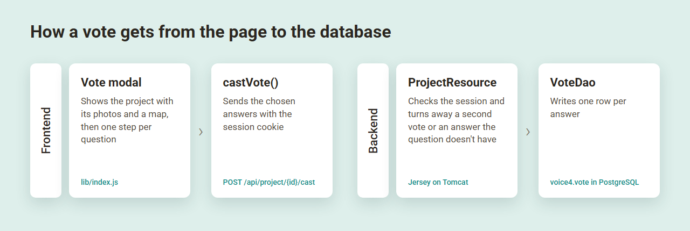
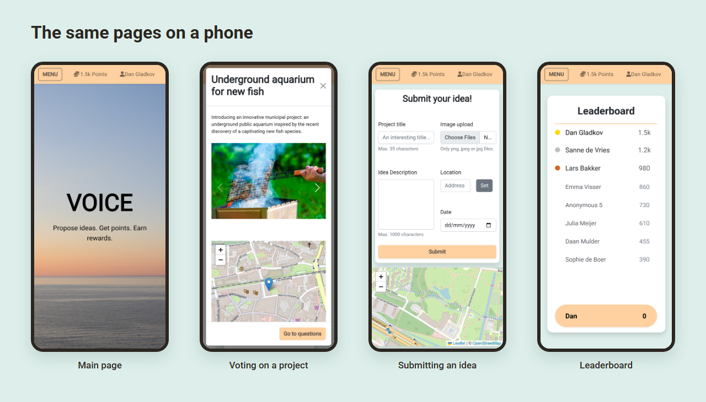

# Voice

Voice is a web app where the citizens of a municipality propose ideas, vote on the city's projects and collect points for a shop. We built it for the client Voice, and I was the frontend lead.

Client project, team of 6, University of Twente • Data & Information module (4) • May to July 2023 • Archived, not maintained

> [!NOTE]
> Voice is the prototype we handed in for the module on 30/06/2023.

## Results / Demo


We built Voice in four sprints, and at the hand-in it ran on a hosted server. We presented it to the client on 06/07/2023.

## How it works

The pages are static HTML with Bootstrap and jQuery, and their scripts call a Jersey REST API whose DAO classes run SQL on PostgreSQL through JDBC. In 2023 the app ran on a hosted Tomcat server that read its database settings from a config file, and this copy runs on a local Tomcat and PostgreSQL.

A citizen signs up with a name, phone number, email and password, and the first account to sign up becomes the admin. The server stores a bcrypt hash of the password, and `UserResource.java` gives every login a new random session token. The pages send that token back in a cookie with each API call, and the API checks it against the stored session.

A citizen proposes an idea with a title, a description, photos and a spot on a Leaflet map. The page turns a typed address into map coordinates with OpenStreetMap's Nominatim search. The idea then waits in the admins' review list.

An admin edits the idea where needed and publishes it as a project with a voting deadline and the points a vote earns. Each project has either a support-or-oppose vote or a few multiple-choice questions. Whoever proposed the idea gets 100 points when `ProjectResource.java` creates the project.

A citizen opens a project from the main page, sees its photos and map and answers its questions one at a time. The server turns away a second vote on the same project and stores one row per answer. Finished projects show their results on the main page.



The leaderboard shows the 10 citizens with the most points, and the shop lists benefits with their price in points. Anyone can switch to anonymous on their account page, and `LeaderboardDao.java` then shows them as "Anonymous".

Built with: Java 17, Jakarta Servlet 6.0.0, Jersey 3.1.1, Jackson 2.15.0, bcrypt 0.10.2, PostgreSQL JDBC 42.6.0, JUnit 5.9.2, Bootstrap 5.2.3, jQuery 3.6.4, Leaflet 1.8.0, js-cookie 3.0.1, Chart.js 4.3.0, Font Awesome 6.1.1, Maven, Tomcat, PostgreSQL

## My contribution

I made 136 of our 695 commits. I built the main page with the project cards and the voting windows, and the submit-idea and review-idea pages with their input checks and map. I also built the admin's form for a project's questions, the leaderboard, the account page, the login and sign-up pages and the news pages. I made the navigation bar and the shared stylesheet with Voice's colors, and on the last day I made the pages work on a phone.



In the rest of the team, one set up the project and built most of the backend, and one wrote the data layer and its tests. Two connected the pages to the API, and one built the admin pages for the shop and the users.

## Running it

It needs Linux or WSL with Java 17, Maven, PostgreSQL 14, Tomcat 10.1 and Python 3. I ran it in WSL with Ubuntu 22.04.

1. Create the database and its tables:

   ```bash
   sudo -u postgres psql -c "CREATE ROLE voice LOGIN PASSWORD 'voice-local'"
   sudo -u postgres createdb -O voice voice
   PGPASSWORD=voice-local psql -h 127.0.0.1 -U voice -d voice -f db/schema.sql
   ```

2. Create the upload folder for the user that runs Tomcat:

   ```bash
   sudo mkdir -p /opt/voice-files && sudo chown $USER /opt/voice-files
   ```

3. Build the app and deploy it as Tomcat's root app, with `$CATALINA_HOME` pointing at Tomcat:

   ```bash
   mvn package
   cp target/voice.war $CATALINA_HOME/webapps/ROOT.war
   $CATALINA_HOME/bin/catalina.sh run
   ```

4. In a second terminal, fill it with demo data:

   ```bash
   python3 db/seed.py
   ```

5. Open http://localhost:8080/login.html and log in as `admin@voice.local` with the password in `db/seed.py`.

## Project structure

| File | Purpose |
|---|---|
| [`src/main/webapp/`](src/main/webapp) | Holds the pages, their scripts in `lib/` and the stylesheets in `css/` |
| [`src/main/java/voiceapp/`](src/main/java/voiceapp) | Implements the REST API and the DAO classes, one package per feature |
| [`src/main/test/`](src/main/test) | Holds our DAO tests, which need a database and sit outside Maven's test folder, so `mvn package` doesn't run them |
| [`db/schema.sql`](db/schema.sql) | Creates the database schema |
| [`db/seed.py`](db/seed.py) | Fills a local install with demo citizens, projects, ideas, news and shop items |
| [`docs/post-sprint-2-report.pdf`](docs/post-sprint-2-report.pdf) | Describes our use cases, class diagram, database design and the first deployed prototype (our names and student numbers removed) |
| [`docs/security-analysis-and-testing.pdf`](docs/security-analysis-and-testing.pdf) | Lists our security requirements and the results of our API and manual tests (our names and student numbers removed) |
| [`docs/database-schema.pdf`](docs/database-schema.pdf) | Documents our 2023 database schema table by table |
| [`pom.xml`](pom.xml) | Builds the app with Maven |
| [`assets/`](assets) | Holds the images in this README |

I rebuilt `db/schema.sql` from the queries in the DAO classes and wrote `db/seed.py` for the demo data. Five files differ from our last commit so that the app runs locally (`DBManager.java`, `FileRepo.java`, `web.xml`, `index.js` and `index.css`), and I left out files that nothing used.

### Not included in this archive

- The photos in the pages, which were stock photos and images we made with AI in early 2023. The stock photos aren't ours to publish, so I left all of them out.
- Our 2023 database and its data, which stayed on the servers we used then.
- The sprint 1 report and the final slides, because their mockups and screenshots show those photos.

## Known issues and limitations

- The Vote button on a support-or-oppose project opens nothing, because it points at `#updownModal` while the window's id ends in the project id.
- Two questions can share a radio button id, so picking the first answer of a later question can tick an answer in an earlier one.
- A vote never pays out the points on a project card (the "+N"), because nothing calls `VoteDao.addPoints`.
- The "Add to shopping cart" button in the shop has no click handler, so citizens can't spend their points.

<br><br>

<p align="center"><em>Empower your voice! Unleash your potential!</em></p>
