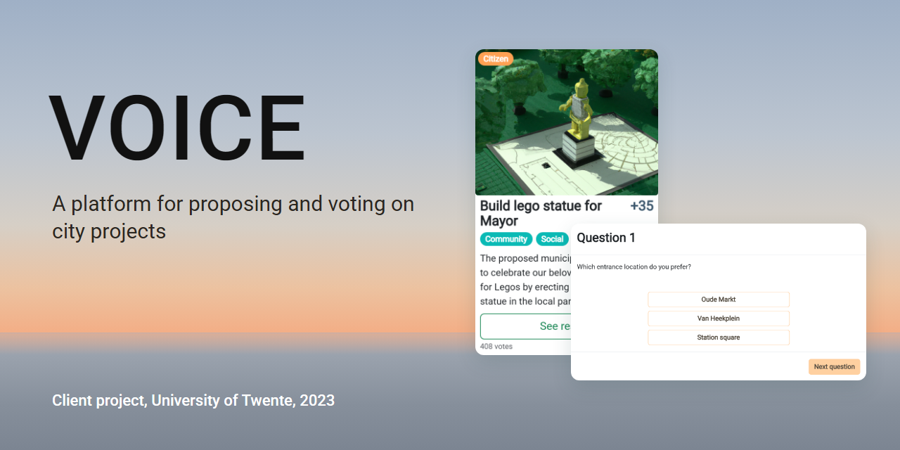
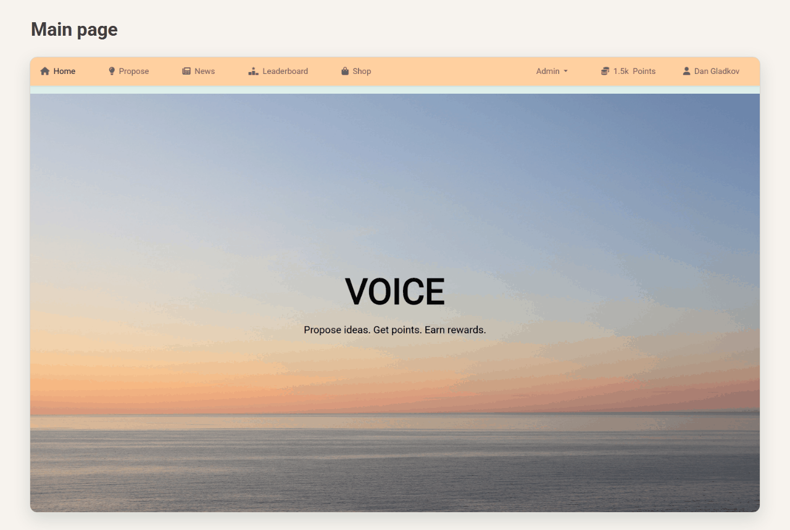

# Voice

Voice is a citizen voting platform that my team built for a client. The client wanted a web app where the citizens of a municipality propose ideas, vote on projects and earn points to spend in a shop. Several teams built their own version for the same client. I was the frontend lead and built the voting flow and most of the pages a citizen sees.

Client project, Technical Computer Science, University of Twente · module 4, May to July 2023 · team of 6

> [!NOTE]
> This is our code from the last commit on 30/06/2023, with five files changed so it runs locally the way it ran in 2023. The photos in the pages aren't included, so a local run shows empty frames where the screenshots below have pictures.

## Demo

I ran the app locally in November 2026 and filled it with the demo data from `db/seed.py` for these screenshots.



## How it works

The pages are static HTML with Bootstrap 5 and jQuery, and each page's script in `lib/` calls a REST API under `/api`. The API is Jersey on Tomcat, and its DAO classes run SQL on PostgreSQL through JDBC.

A citizen proposes an idea with photos and a spot on a Leaflet map. An admin reviews it and publishes it as a project with a voting deadline and either a support-or-oppose vote or a few multiple-choice questions. Whoever proposed the idea then gets 100 points for the shop. The leaderboard shows the 10 citizens with the most points, and anyone can switch to anonymous on their account page. The server hashes passwords with bcrypt, a session token in a cookie goes with every API call, and the first account to sign up becomes the admin.


The Vote button on a support-or-oppose project still opens nothing, as it did in 2023, because it points at `#updownModal` while the window's id ends in the project id. Two questions can also share a radio button id, so picking the first answer of a later question can tick an answer in an earlier one.

## My part

I made 136 of our 695 commits. I built the main page with the project cards and the voting windows (the steps through a project's questions and the map in each window), the submit-idea and review-idea pages with their input checks, and the form where an admin adds questions and answers to a project. I also built the leaderboard, the account page with the anonymous switch, the login and sign-up pages with the password rules, the news pages, the navigation bar on every page and the shared stylesheet with Voice's colours and buttons. On the last day I made the pages work on a phone.


Of the other five, one set up the project and built most of the backend (the REST API, logins and sessions, file uploads and the deployment), one wrote the data layer and its tests, two connected the pages to the API (cookies, voting, projects, the shop, news and sign-up), and one built the admin pages for the shop and the users.

## What's in here

| File | Purpose |
|---|---|
| [`src/main/webapp/`](src/main/webapp) | The pages, their scripts in `lib/`, the stylesheets in `css/` and the icons |
| [`src/main/java/voiceapp/`](src/main/java/voiceapp) | The REST API and the DAO classes, one package per feature |
| [`src/main/test/`](src/main/test) | Our DAO tests, which need a database and sit outside Maven's test folder, so `mvn package` doesn't run them |
| [`db/schema.sql`](db/schema.sql) | The database schema |
| [`db/seed.py`](db/seed.py) | Fills a local install with demo citizens, projects, ideas, news and shop items |
| [`pom.xml`](pom.xml) | The Maven build |
| [`assets/`](assets) | The images in this README |

I rebuilt the schema from the queries in the DAO classes, because our database lived on the university's server. The five changed files are `DBManager.java`, which connects to a local database instead of the university's, `FileRepo.java`, which saves uploads to `/opt/voice-files/`, `web.xml`, which registers the API, JSON and file uploads with Jersey, `index.js`, which now reads the finished projects' ids the way the API returns them, and `index.css`, where current Chrome needs the main photo pinned to the top left.

## What's not here

- The photos the pages show, which were stock photos and images we generated with AI in early 2023. The stock photos aren't ours to publish, so I left all of them out.
- Our database on the university's server and everything in it.
- The sprint reports, the changelog and the design documents, which carry our student numbers.
- IDE settings and uploaded files.

## Running it

It needs Linux or WSL with Java 17, Maven, PostgreSQL 14, Tomcat 10.1 and Python 3. I ran it in WSL with Ubuntu 22.04.

1. Create the database and its tables:

   ```bash
   sudo -u postgres psql -c "CREATE ROLE voice LOGIN PASSWORD 'voice-local'"
   sudo -u postgres createdb -O voice voice
   PGPASSWORD=voice-local psql -h 127.0.0.1 -U voice -d voice -f db/schema.sql
   ```

2. Create the upload folder for the user that runs Tomcat:

   ```bash
   sudo mkdir -p /opt/voice-files && sudo chown $USER /opt/voice-files
   ```

3. Build the app and deploy it as Tomcat's root app, with `$CATALINA_HOME` pointing at Tomcat:

   ```bash
   mvn package
   cp target/voice.war $CATALINA_HOME/webapps/ROOT.war
   $CATALINA_HOME/bin/catalina.sh run
   ```

4. In a second terminal, fill it with demo data:

   ```bash
   python3 db/seed.py
   ```

5. Open http://localhost:8080/login.html and log in as `admin@voice.local` with the password in `db/seed.py`.

<br><br>

<p align="center"><em>Empower your voice! Unleash your potential!</em></p>
